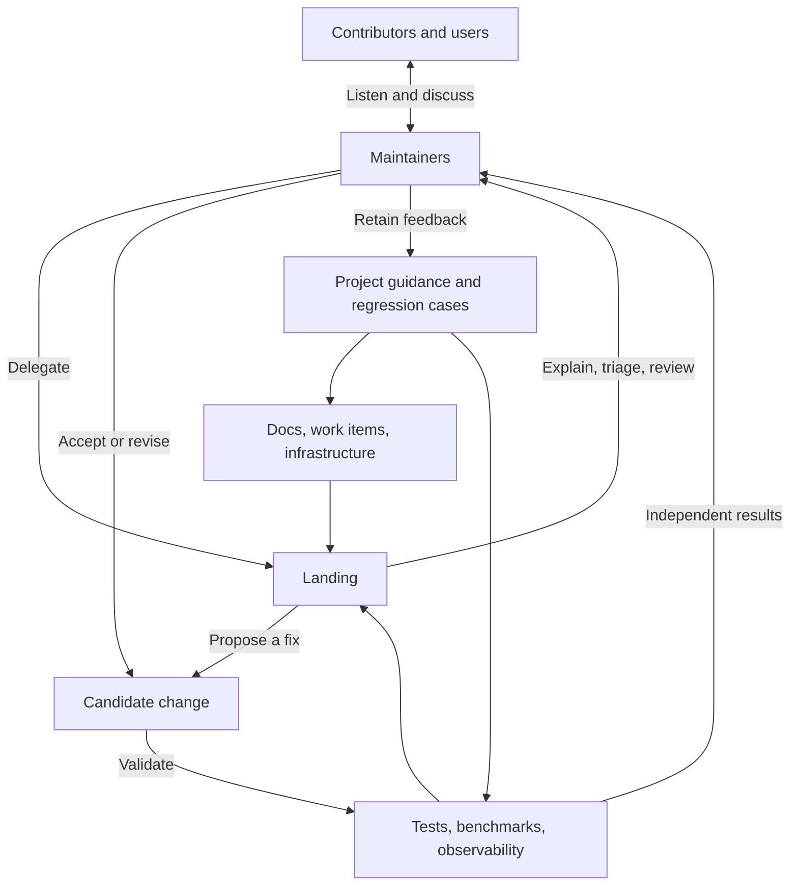

# Working with Landing

Landing can investigate a failure, prepare an issue, make a change, run checks, and publish a review within the authority you give it. Results depend on the engineering context your team maintains and the evidence you use to accept the work.

## Connect the engineering context

Give Landing the material that establishes intended behavior and acceptance criteria: documentation, work items, infrastructure, tests, benchmarks, and observability. Expose it through workspace files, focused task inputs, or tools in the prepared environment.

Load only what the question needs and let the agent fetch a specific log or discussion when it does. Preparing the system does not mean loading every document into every task.



Landing helps maintainers act on evidence they already receive; it does not replace native checks or operational signals. Each command works independently.

## Delegate a concrete task

Use `explain` for a question, `triage` to make a problem actionable, `fix` for a repair, `review` to evaluate a candidate, and `bump` to update dependencies. State the unresolved condition, the expected outcome, the constraints that matter, and the evidence that would settle it.

```text
Fix the documented timeout behavior. Reproduce the failure, preserve the public CLI contract, and use the existing acceptance check. Report the observed result and any remaining uncertainty.
```

Reuse the issue that already describes a problem. Automatic follow-up updates it only when evidence, conditions, or verified progress change; a new run alone does not justify another comment. Explicit questions still get a reply.

## Verify the outcome

Reuse independent checks that cover the candidate and its environment, and name the revision when it affects the conclusion: a pull request head, a CI merge checkout, and a deployed commit can differ. Resolve an unresolved question with source inspection or the smallest counterexample.

Keep distinct claims distinct. Task completion, a model recommendation, a published reply, and actual recovery establish different things, and an `allow` recommendation does not replace acceptance evidence. A review finding should state a supported trigger and its consequence at the place someone would repair it.

Record useful findings and mistaken assumptions in the work item. Improve project guidance, tools, code, or checks where the problem belongs. Behavior tests cover the experience users see; regression tests cover mistakes likely to recur.

Automation can handle investigation and publication within its authorization. Keep the human part — welcoming contributors, understanding concerns, resolving disagreement — with maintainers.
